# SYNCO

<div align="center">

### v0.1 — Prototype screens

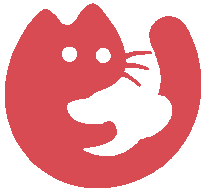

<picture>
  <source media="(prefers-color-scheme: dark)" srcset="docs/brand/wordmark-white.png">
  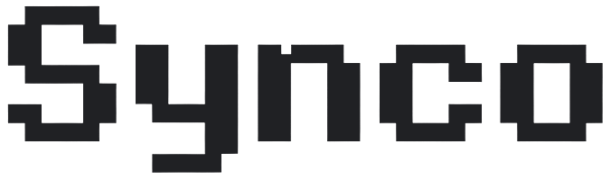
</picture>

[](https://kotlinlang.org/)
[](https://developer.android.com/compose)
[](https://developer.android.com/)
[](https://m3.material.io/)
[](https://www.figma.com/make/)

*A culture-first social app: meet people through the films, music and books you share, then watch, listen and read together. This is the native Android app, rebuilt screen by screen in Jetpack Compose from the Synco prototype designed in Figma Make.*

[]()
[]()
[]()

</div>

---

> [!IMPORTANT]
> **Screens only — for now.** Every screen and dialog of the Synco prototype is on Android, in both themes, and was run on an emulator. The login screens are still being designed, and a visual polish pass comes after them. There is no backend yet: every person, room and conversation is demo data.

> [!NOTE]
> **Source of truth:** the Figma Make prototype. Sizes, colors, spacing and copy were taken from the prototype as rendered (measured at 375×812, light and dark), not redrawn by eye. The app's interface text is in Brazilian Portuguese, as in the design.

---

## Table of Contents

- [Screens](#-screens)
- [About](#-about)
- [Features](#-features)
- [Tech Stack](#️-tech-stack)
- [Design System](#-design-system)
- [Architecture Overview](#️-architecture-overview)
- [Getting Started](#-getting-started)
- [Project Structure](#-project-structure)
- [Roadmap](#️-roadmap)
- [Known Limitations](#️-known-limitations)
- [What I Learned](#-what-i-learned)

---

## 📱 Screens

| Feed | Match | Chats | Conversation | Groups |
|:---:|:---:|:---:|:---:|:---:|
| 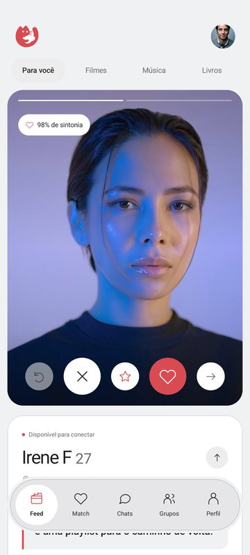 | 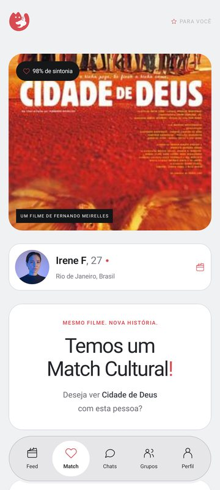 | 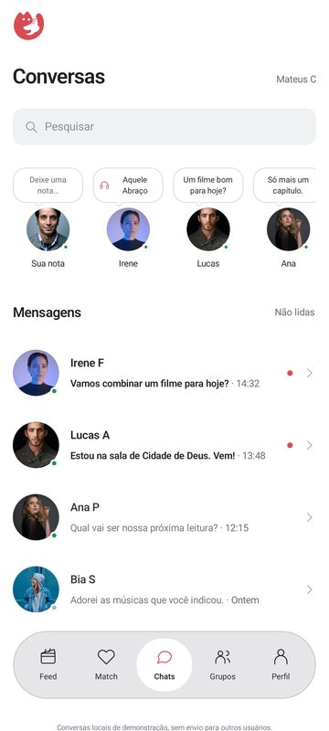 | 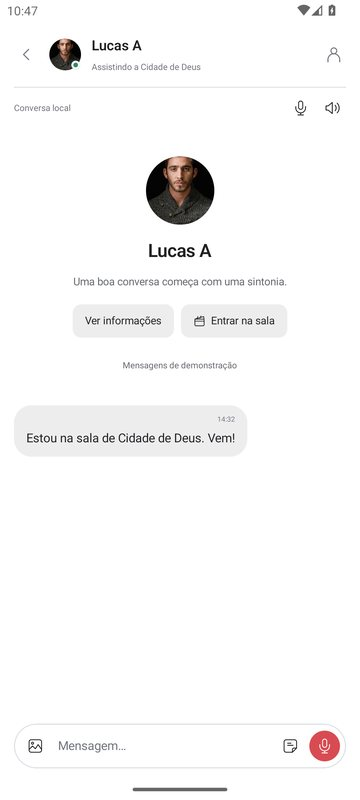 | 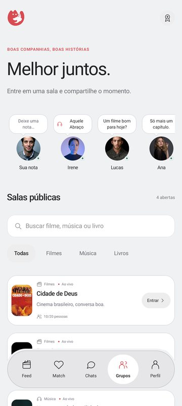 |

| Live room | Profile | Rewards | Feed (dark) | Settings (dark) |
|:---:|:---:|:---:|:---:|:---:|
| 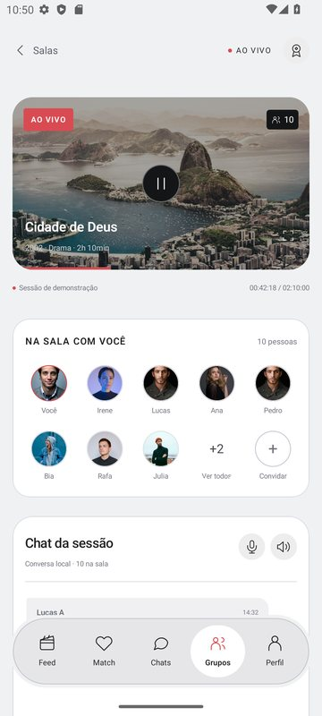 | 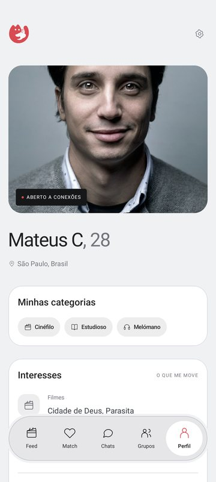 | 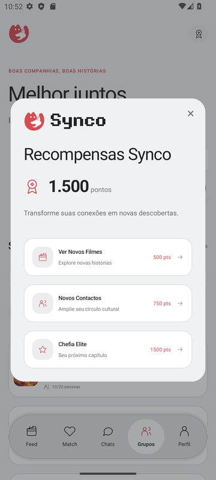 | 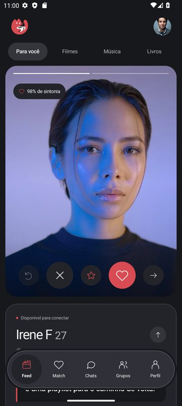 | 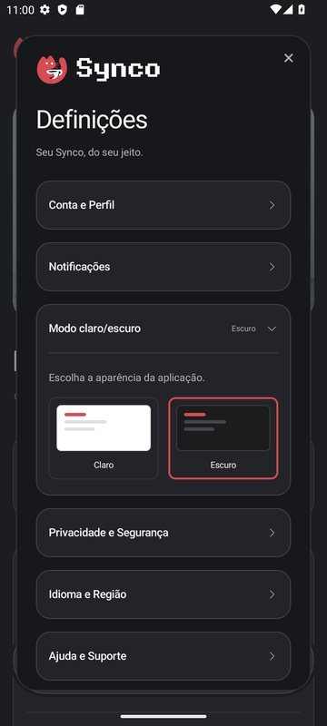 |

*Captured on the `Medium_Phone` emulator (API 33, 1080×2400).*

---

## 🧩 About

Synco starts a connection from what two people already have in common. The Feed shows a person and their cultural universe, along with how in tune the two of you are; a match becomes an invitation to watch the same film together or build a shared playlist. Beyond one-to-one, public rooms gather people around a film, an album or a book club while it plays, with a chat for the session. Notes show what friends are listening to or thinking about, and a small rewards system turns connections into new discoveries.

The design lives in a Figma Make project — a working React prototype. This repository is its native Android counterpart: the same screens, the same flows, the same copy, written in Kotlin with Jetpack Compose. No WebView, no wrapped web code.

The port was measured, not eyeballed. The prototype's stylesheet had over a thousand rules, many overriding each other, so the specification came from what the browser actually computed for every element of every screen — in the light theme and again in the dark one. The logo, wordmark and film poster are byte-identical to the prototype's files (checked by SHA-256), and the 28 icons are the prototype's own SVG paths.

---

## ✨ Features

| Component / Feature | Description | Status |
|---|---|---|
| 🎬 **Discovery Feed** | One person at a time: portrait and cultural-universe photo tabs, an affinity chip, city, bio, interests in common, and a details toggle. Filters for For you / Films / Music / Books. | ✅ Done |
| 👆 **Swipe and Actions** | Drag the card past 65 dp to like (right) or pass (left), or use the rewind, pass, special interest, like and share buttons. Likes, special interests and shares are confirmed with a toast. | ✅ Done |
| 🫙 **Empty Feed** | When a selection runs out: a "good connections take time" message, with buttons to review the profiles again or go back to the last one. | ✅ Done |
| ❤️ **Cultural Match** | Film poster, compatibility, and the person you matched with. Accept and schedule a session with the native date and time pickers, or create a shared playlist. | ✅ Done |
| 💬 **Inbox** | Conversations with presence dots, search, and an unread filter that remembers which conversations you opened. | ✅ Done |
| 📝 **Notes and Presence** | A strip of notes — a message, or a song and its artist — with an Online / Offline / Do not disturb status. Edit your own; open a friend's and jump to the conversation. | ✅ Done |
| 🗨️ **Private Conversation** | Intro card, message bubbles, text, photos through the system photo picker (no storage permission needed), four Synco stickers, and microphone and sound toggles. | ✅ Done |
| 🎙️ **Voice Messages** | Recording bar with a timer, discard and send. Sends a voice-message placeholder; nothing is recorded. | 🧪 Simulated |
| 🏠 **Public Rooms** | Rooms by category with search, filters, live badge, capacity and host, plus an empty state. | ✅ Done |
| 📺 **Live Room** | Video card with play/pause and expand, session progress, who is in the room (with a members dialog and an invite link), and a session chat with photo, sticker and audio actions. | ✅ Done |
| 👤 **Profile** | Photo with an "open to connections" tag, categories, interests, and a dialog to edit your name. | ✅ Done |
| 🪪 **Contact Profile** | Opened from a conversation: a conversation starter, what the person is sharing right now, and a shortcut into that room. | ✅ Done |
| ⚙️ **Settings** | Seven expandable sections: account, notifications, appearance, privacy (with safety tips), language and region, help, and about. | ✅ Done |
| 🌓 **Light and Dark Themes** | Both palettes from the prototype. System bar icons follow the app's theme, not the phone's, and the wordmark turns white in dark mode. | ✅ Done |
| 🏅 **Rewards** | Points balance and three rewards; redeeming checks the balance and says so when there are not enough points. | ✅ Done |
| 🧭 **Navigation** | Floating bottom bar with a ring of page background around it; inner screens on a back stack. Android's back closes a dialog first, and the bar hides inside a conversation. | ✅ Done |
| 🍞 **Toasts** | Confirmations above the bottom bar for 3.5 s, as in the prototype. | ✅ Done |
| 🖼️ **Images** | Logo, wordmark and poster bundled; people and room photos loaded from Unsplash with Coil, as the prototype does. | ✅ Done |
| 🔤 **Inter Typeface** | The prototype's font. The app uses the system sans-serif until the font file is added. | 🔨 Planned |
| 🔐 **Login and Sign-up** | Being designed in Figma Make. | 🔨 Planned |
| 💾 **Persistence** | Keep notes, preferences and the theme across launches. | 🔨 Planned |
| 🌐 **Backend** | Real accounts, profiles, rooms and messages. | 🔨 Planned |

---

## 🛠️ Tech Stack

| Technology | Role |
|---|---|
| Kotlin 2.2.10 | Language — the Kotlin built into the Android Gradle Plugin |
| Jetpack Compose (BOM 2026.02.01) | UI toolkit — Compose UI 1.10.4 |
| Material 3 1.4.0 | Theme plumbing, menus and the system-styled components |
| Activity Compose 1.13.0 | `setContent`, edge-to-edge, back handling, photo picker |
| AndroidX ViewModel | App state that survives rotation |
| Coil 3.3.0 + OkHttp | Remote images (Unsplash) and bundled drawables |
| Android Gradle Plugin 9.4.1 · Gradle 9.6.0 | Build |
| JDK 21 | Gradle daemon toolchain; bytecode targets Java 11 |
| Android SDK | minSdk 24 · targetSdk 36 · compileSdk 36.1 |
| Figma Make | Design source — the React prototype |

---

## 🎨 Design System

Every screen reads its colors from one theme object, so a component written once is right in both themes. The tokens are named after the prototype's CSS variables (`--feed-background`, `--feed-card`, `--muted`, …).

| Token | Light | Dark | Used for |
|---|---|---|---|
| `Accent` | `#D94B52` | `#D94B52` | Primary buttons, likes, live markers |
| `background` | `#F0F1F3` | `#17181B` | Page background |
| `card` | `#FFFFFF` | `#232429` | Cards, bubbles, the Chats page |
| `ink` | `#202123` | `#F2F2F3` | Main text and icons |
| `secondary` | `#686A70` | `#B4B5BC` | Supporting text |
| `chip` | `#EDEDEE` | `#34353B` | Pills, selected filters, icon boxes |
| `cardBorder` | `#DCDDE3` | `#41434C` | Card outlines and dividers |
| `presenceOnline` | `#39846A` | `#67B995` | Online dots |

In total, 32 colors change with the theme and 22 stay fixed (overlays on photos, the video card, stickers).

**Type** is set with one helper that takes the prototype's CSS values directly — size and line height in px become sp, letter spacing in px becomes sp, and the line height defaults to 1.5 × size, the prototype's own default:

```kotlin
Text(
    room.title,
    style = syncoText(14f, 500, lineHeight = 18.2f, letterSpacing = -0.2f),
    color = SyncoTheme.colors.ink,
)
```

**Icons** are the prototype's SVG path strings, drawn as Compose `ImageVector`s on a 24-unit grid with round caps — a 1.25 stroke for the app icons and 1.4 for the social ones, exactly as the prototype sets them:

```kotlin
SyncoIcon(Glyph.Heart, 13.dp, tint = Accent)
```

**Shapes** follow the prototype's radii: 26 dp for cards, 22 dp for list cards, 18 dp for chips and settings sections, 28 dp for full-width buttons.

---

## 🏗️ Architecture Overview

```
 Figma Make prototype (React)
      │  source, computed styles (light + dark), image files
      ▼
 ui/theme  ──  SyncoColors (light / dark) · syncoText() · Glyph icons
      │
      ▼
 MainActivity  ──  edge-to-edge; system bars follow the app's theme
      │
      ▼
 SyncoApp  ──  current Route → screen
      │         BottomNav (hidden inside a conversation)
      │         AppModalHost (every dialog, drawn at the root)
      │         Toast (3.5 s)
      ▼
 SyncoViewModel  ──  back stack · theme · dialogs · feed · notes · chats
      │
      ▼
 SocialData  ──  demo people, rooms, profiles, notes, stickers
      │
      ▼
 Coil  ──  Unsplash photos · bundled logo, wordmark and poster
```

Routes mirror the prototype's paths — a conversation is `Route.Chats(contactId)` and a live room is `Route.Groups(roomId)`, each matching a path of the prototype — so a flow in the prototype maps one to one onto the app.

---

## 🚀 Getting Started

**1. Clone the repository**

```bash
git clone https://github.com/EduhxH/Synco.git
```

```bash
cd Synco
```

**2. Open it in Android Studio**

Use a recent Android Studio with Android Gradle Plugin 9.4 support. It needs the Android SDK Platform 36.1 and a JDK 21 for Gradle — Android Studio's bundled JBR works. Let the Gradle sync finish.

**3. Run it**

Pick an emulator or a phone (Android 7.0, API 24, or newer) and run the **kult** configuration. From a terminal instead:

```bash
./gradlew :kult:installDebug
```

```bash
adb shell am start -n com.kult.app/.MainActivity
```

On Windows, use `gradlew.bat` in place of `./gradlew`.

**4. Try the flows**

The device needs internet for the people and room photos. Everything else works offline. To see the dark theme, open the **Profile** tab, tap the gear icon, expand the light/dark mode section and pick the dark option.

**5. Build an APK without installing**

```bash
./gradlew :kult:assembleDebug
```

The APK lands in `kult/build/outputs/apk/debug/`.

---

## 📂 Project Structure

```
Synco/
├── kult/                                    # Android app module
│   ├── build.gradle.kts                     # Compose, Coil, SDK levels
│   └── src/main/
│       ├── AndroidManifest.xml              # INTERNET, for the remote photos
│       ├── java/com/kult/app/
│       │   ├── MainActivity.kt              # Edge-to-edge, theme-aware system bars
│       │   ├── SyncoViewModel.kt            # Back stack, dialogs, toasts, feed, notes, chats
│       │   ├── data/
│       │   │   └── SocialData.kt            # Demo people, rooms, profiles, notes, stickers
│       │   └── ui/
│       │       ├── SyncoApp.kt              # Root: screen, bottom bar, dialogs, toast
│       │       ├── navigation/Route.kt      # Tabs and routes, mirroring the prototype's paths
│       │       ├── theme/                   # Color tokens, text styles, theme
│       │       ├── icons/Glyph.kt           # 28 line icons from the prototype's SVG paths
│       │       ├── components/              # Buttons, cards, fields, switch, select, modal, nav
│       │       ├── screens/
│       │       │   ├── FeedScreen.kt        # Discovery feed
│       │       │   ├── MatchScreen.kt       # Cultural match
│       │       │   ├── ChatsScreen.kt       # Inbox and private conversation
│       │       │   ├── SessionChat.kt       # Chat shared by conversations and rooms
│       │       │   ├── GroupsScreens.kt     # Public rooms and the live room
│       │       │   ├── ProfileScreens.kt    # Your profile and a contact's
│       │       │   └── NotesStrip.kt        # Notes, presence and their dialogs
│       │       └── dialogs/AppDialogs.kt    # Settings, rewards, edit profile, schedule, playlist…
│       └── res/
│           ├── drawable-nodpi/              # Logo, wordmark, poster — identical to the design
│           └── values/                      # Launch theme and window colors
├── docs/
│   ├── brand/                               # Logo and wordmark for this README
│   └── screens/                             # Screenshots for this README
├── gradle/libs.versions.toml                # Version catalog
└── settings.gradle.kts
```

---

## 🗺️ Roadmap

- [x] Compose project setup replacing the Views template
- [x] Design tokens taken from the prototype, light and dark
- [x] 28 line icons ported from the prototype's own path data
- [x] Feed with discovery card, swipe, rewind, filters and empty state
- [x] Cultural match with session scheduling and a shared playlist
- [x] Chats: inbox, notes and presence, private conversation with photos and stickers
- [x] Groups: public rooms with search and filters, live room with session chat
- [x] Profile, contact profile and settings with the theme switch
- [x] Rewards, notes and every other dialog of the prototype
- [x] Run on an emulator in both themes — two bugs found and fixed
- [ ] Login and sign-up screens
- [ ] Visual polish pass
- [ ] Inter typeface bundled
- [ ] Synco launcher icon and app name
- [ ] Persist notes, preferences and theme
- [ ] Real voice messages: recording and playback
- [ ] Backend: accounts, profiles, rooms and messages
- [ ] UI tests

---

## ⚠️ Known Limitations

- **Demo data only.** People, rooms, notes and conversations come from the prototype. Apart from fetching photos, nothing leaves the device.
- **State lives in memory.** It survives rotation, but notes, sent messages, points, preferences and the theme reset when the app process ends.
- **Voice messages are simulated.** The recording bar, timer, discard and send all work; what arrives in the chat is a placeholder. No microphone permission is requested.
- **Photos need internet.** People and room photos load from Unsplash, as in the prototype; offline, a neutral placeholder shows in their place.
- **System font instead of Inter.** Swapping it is one line in `ui/theme/Type.kt` once the font file is added to the project.
- **Coil is pinned to 3.3.0.** Coil 3.4 and newer are built with Kotlin 2.3+, and the Android Gradle Plugin 9.4.1 build uses Kotlin 2.2.10. Raising the Kotlin version, and the Compose compiler plugin with it, unlocks newer releases.
- **Share and invite links are placeholders.** They copy a `synco://` link to the feed or the room; no deep links are registered yet.
- **The launcher icon and app name are still the template's** (`kult`).
- **Phone-first.** On tablets the content is capped at 560 dp wide, as the prototype caps it; there is no tablet layout.

---

## 🧠 What I Learned

- **Computed styles are a better spec than a stylesheet** — with over a thousand rules overriding each other, the honest numbers were the ones the browser computed for each element, on each screen, in each theme.
- **Tokens first, screens second** — once every color came from a theme object, the dark theme was a second palette rather than a second implementation.
- **Icons are data** — porting the prototype's SVG path strings into `ImageVector`s kept every icon identical without an icon font or a library.
- **Dialogs do not belong inside scrolling content** — a dialog drawn inside a `verticalScroll` column was measured with infinite height and crashed the app; every dialog now lives at the root.
- **Edge-to-edge means handling the keyboard yourself** — once the app draws behind the system bars, the window stops resizing for the keyboard, and `imePadding()` has to bring the focused field back into view.
- **The Kotlin version is a dependency constraint too** — a library's newer releases can need a newer Kotlin compiler than the build has.

---

## 🤝 Contributing

This is a personal learning project, but if you spot a bug or want to discuss an idea, open an issue first so we can talk before any code is written.

---

<div align="center">
  Made with 💜 by <a href="https://github.com/EduhxH">EduhxH</a>
</div>
